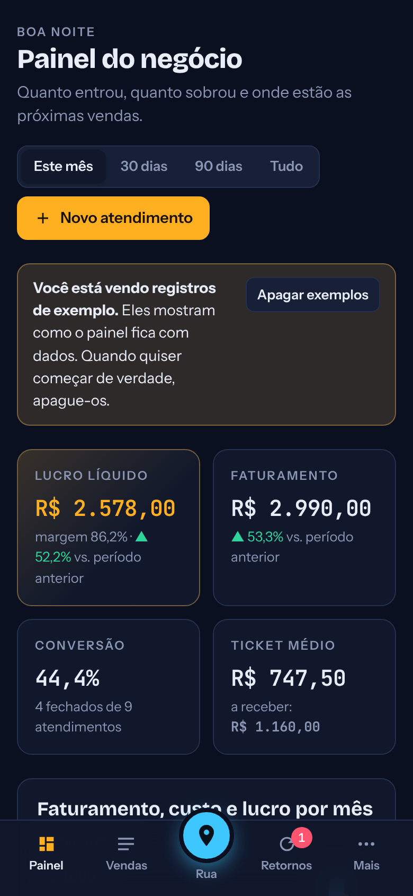
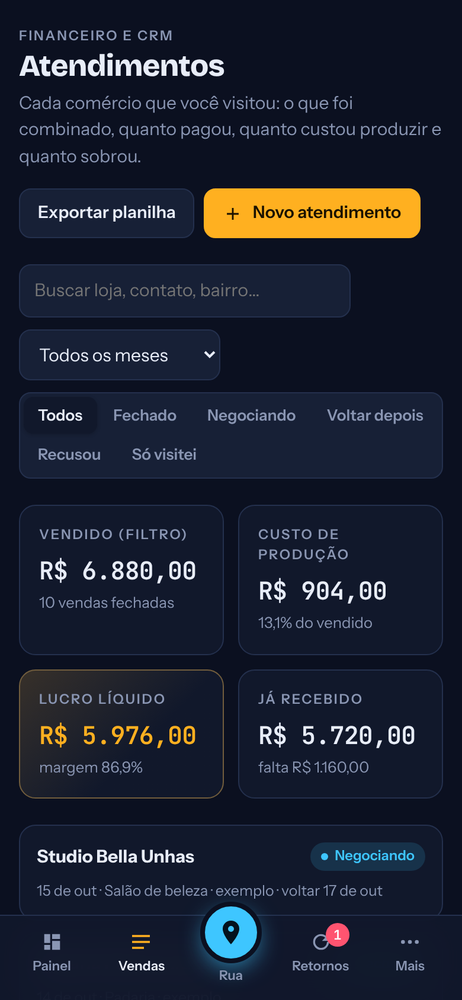
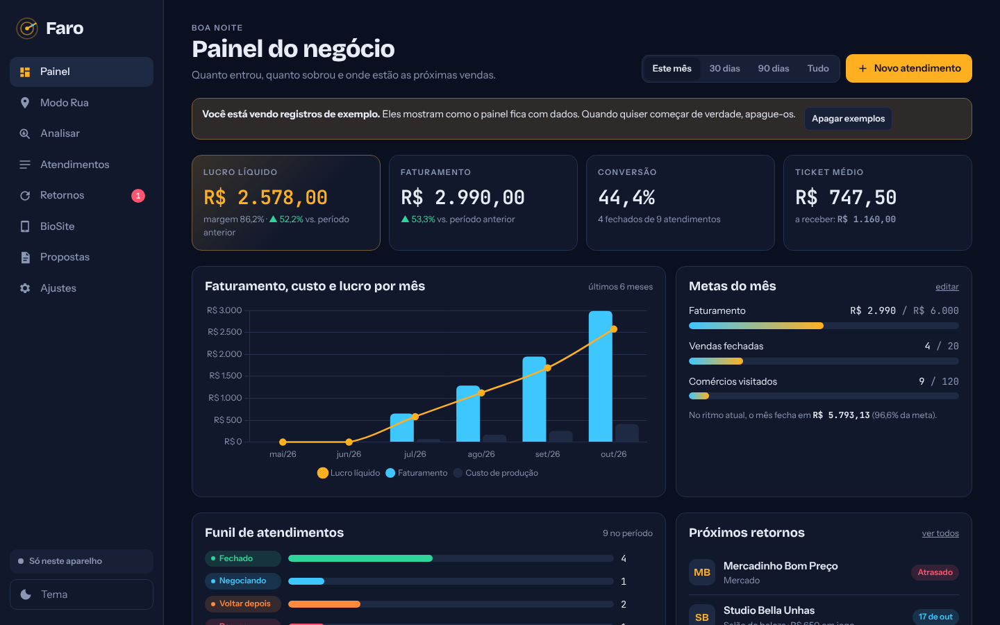

# FaroMaps

App web que uso para vender na rua. Eu ando pelo bairro com o celular, o app mostra os comércios ao redor, diz quais têm o perfil do Google mais fraco (e por isso são os melhores clientes para a Faro Digital) e depois controla cada atendimento até o dinheiro entrar.

> O código completo fica em um repositório privado, porque é a ferramenta de trabalho do meu negócio. Aqui estão as telas, a arquitetura e alguns módulos selecionados. Posso mostrar o restante em uma entrevista.

<p>
  
  
  
</p>



## O problema

Eu vendo placas de avaliação NFC, otimização de Google Meu Negócio, BioSites e sites para comércio local. Antes, eu escolhia onde entrar no chute e anotava tudo no bloco de notas. Não sabia quanto realmente sobrava depois do custo de produção, nem quem tinha pedido para eu voltar.

## O que o app faz

- **Modo Rua:** GPS ao vivo, radar e mapa com os comércios em volta. Busca de novo sozinho quando eu me afasto o bastante do ponto da última busca (a distância acompanha o raio configurado).
- **Nota do perfil (0 a 100):** analisa site, telefone, horário, fotos, nota, quantidade e recência das avaliações, descrição e categoria. Mostra o que falta e sugere qual serviço oferecer.
- **Analisar sem API:** colo o texto de um perfil do Google Maps e o app extrai nome, nota, telefone, endereço e horário, sem gastar cota de API.
- **Atendimentos (CRM + financeiro):** status, itens, valor, custo, lucro, forma de pagamento, valor recebido e motivo de recusa. Exporta CSV.
- **Painel:** lucro líquido, faturamento, conversão, ticket médio, gráfico mensal, metas com projeção e funil.
- **Retornos:** quem está atrasado, para hoje e para a semana, com mensagem de WhatsApp pronta.
- **BioSite e propostas:** gera a página de link na bio do comércio e o orçamento para mandar no WhatsApp.

## Decisões técnicas

- **JavaScript puro com ES Modules**, sem framework nem etapa de build. Cada tela é um módulo, e um roteador simples por hash troca entre elas.
- **Duas fontes de dados de mapa.** Google Places API (New) quando há chave configurada; OpenStreetMap via Overpass API como alternativa gratuita, com três servidores em sequência caso um falhe.
- **Offline first.** Os dados ficam no `localStorage` e o app funciona sem internet. Com a sincronização ligada, o Supabase guarda uma cópia por usuário (com Row Level Security) e, se o mesmo registro for editado em dois aparelhos, vale a edição mais recente.
- **PWA instalável** com service worker e manifest, para abrir como app no celular.
- **Economia de API:** só busca de novo quando a posição muda e só carrega fotos e avaliações quando abro um comércio.

## Stack

JavaScript (ES Modules) · HTML · CSS · Google Maps JavaScript API · Places API (New) · OpenStreetMap / Overpass API · Leaflet · Chart.js · Supabase · Netlify

## Amostras de código

| Arquivo | O que mostra |
|---|---|
| [`gmn.js`](amostras-de-codigo/gmn.js) | Cálculo da nota do perfil. Itens que não dá para verificar ficam fora da conta, em vez de puxar a nota para baixo. |
| [`osm.js`](amostras-de-codigo/osm.js) | Busca de comércios pela Overpass API, com tradução das categorias e troca de servidor em caso de falha. |
| [`util.js`](amostras-de-codigo/util.js) | Funções de apoio: datas, moeda, distância entre coordenadas e telefone/WhatsApp. |

## Estrutura do projeto completo

```
index.html          casca do app e navegação
css/style.css       tema escuro e claro
js/app.js           rotas, tema e menu
js/store.js         dados no aparelho, backup e junção com a nuvem
js/sync.js          login e sincronização com o Supabase
js/rua.js           GPS, radar, mapa e detalhes do comércio
js/google.js        Google Maps + Places API (New)
js/osm.js           comércios pelo OpenStreetMap
js/gmn.js           nota do perfil e oportunidades
js/analisar.js      leitor do texto colado do Google Maps
js/painel.js        dashboard
js/atendimentos.js  financeiro e CRM
js/retornos.js      agenda de retornos
js/biosite.js       gerador de BioSite
js/propostas.js     propostas para WhatsApp
js/config.js        ajustes
sw.js               service worker
```

Os dados nas imagens são registros de exemplo.
